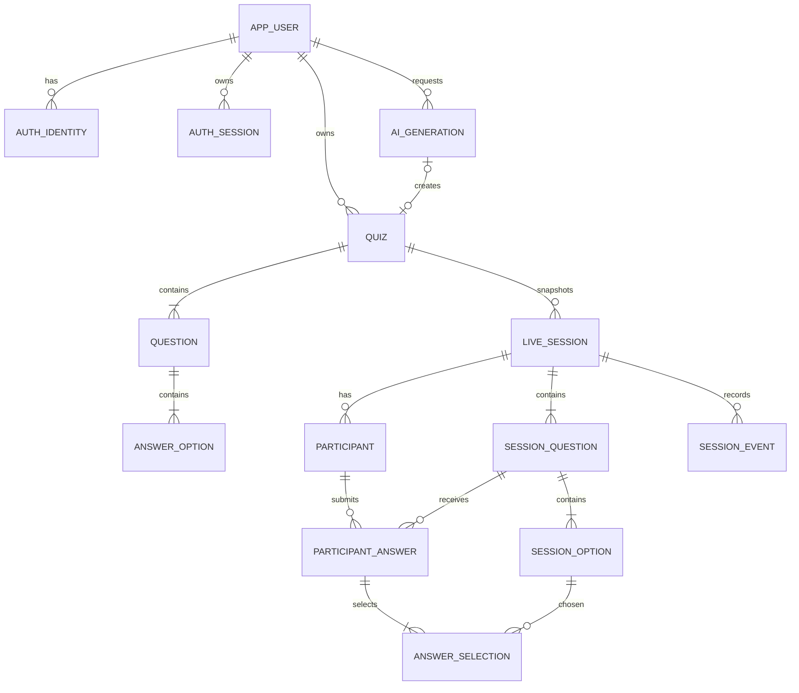

# Database Design

## Conventions

- PostgreSQL 18 on Neon; UTC `timestamptz`; UUIDv7 primary keys generated in Go unless Neon's selected version exposes a vetted native function.
- `citext` for case-insensitive email/username uniqueness; normalized participant names use an application-produced lowercase/whitespace-folded key.
- Tables use singular names in SQL (`app_user`, `quiz`) and plural JSON resource names.
- Public DTOs never expose password hashes, token hashes, provider tokens, `is_correct` before reveal, or internal AI payloads.
- All writes use `context.Context`, parameterized `sqlc` queries, explicit timeouts, and transactions owned by the service layer.
- `created_at` is immutable; code sets `updated_at` on mutation. Optimistic aggregates use integer `version`.

## Entity Relationship Diagram



## Table Catalog

### Identity And Security

| Table | Important columns and constraints | Indexes / deletion |
|---|---|---|
| `app_user` | `id uuid PK`; `email citext NOT NULL UNIQUE`; `username citext NOT NULL UNIQUE`; `display_name varchar(80)`; `password_hash text NULL`; `email_verified_at timestamptz NULL`; `status` check `active,locked,pending_deletion`; timestamps | unique email/username; soft account status, explicit deletion workflow |
| `auth_identity` | `id`; `user_id FK`; `provider` check `google`; `provider_subject varchar(255)`; `provider_email citext`; unique `(provider,provider_subject)`; unique `(user_id,provider)` | cascade with user; provider subject, never email, is external identity key |
| `auth_session` | `id`; `user_id FK`; `token_hash bytea UNIQUE`; `idle_expires_at`; `absolute_expires_at`; `last_seen_at`; `ip_prefix inet`; `user_agent_hash bytea`; `revoked_at` | active lookup on `token_hash`; `(user_id, created_at desc)`; cascade; CSRF token is derived by server HMAC and not stored |
| `oauth_transaction` | `id`; `state_hash`; `nonce_hash`; encrypted `pkce_verifier_ciphertext`; `return_path`; expiry; `consumed_at` | state hash unique; delete after 15 minutes; encryption key remains outside DB |
| `password_reset_token` | `id`; `user_id`; `token_hash UNIQUE`; `expires_at`; `consumed_at` | active token index; cascade |
| `email_verification_token` | same single-use pattern | active token index; cascade |
| `idempotency_key` | `user_id`; `scope`; `key_hash`; request hash; response status/body; expiry; unique `(user_id,scope,key_hash)` | delete after 24 hours; never store auth secrets |

`password_hash` may be null only for Google-only accounts. Adding a password requires recent Google authentication or a valid password-reset/email-verification flow.

### Authoring

| Table | Important columns and constraints | Indexes / deletion |
|---|---|---|
| `quiz` | `id`; `owner_user_id`; title 1-120; description 0-500; `status` check `draft,published,archived`; `version >= 1`; `published_at`; `deleted_at`; timestamps | `(owner_user_id,updated_at desc)` partial where not deleted; status; restrict user delete until account workflow |
| `question` | `id`; `quiz_id`; `position smallint >= 0`; `type` initially `multiple_choice`; prompt 1-500; explanation 0-1000; difficulty; timer 10-180; scoring `fixed,speed`; `base_points` 100-10000; timestamps; unique `(quiz_id,position)` deferrable | `(quiz_id,position)`; cascade |
| `answer_option` | `id`; `question_id`; `position smallint`; text 1-300; `is_correct bool`; unique `(question_id,position)` deferrable | cascade; service and deferred constraint/trigger ensure 2-6 options and exactly one correct for MVP |

PostgreSQL cannot express "exactly one child is correct and at least two children exist" with a simple row check. The service validates it and publication runs a transaction-level validation query. A deferred constraint trigger should reject committed published quiz mutations that violate the invariant; drafts may be incomplete.

### Live And Analytics

| Table | Important columns and constraints | Indexes / deletion |
|---|---|---|
| `live_session` | `id`; `quiz_id NULL`; `host_user_id`; `quiz_version`; `join_code char(6)`; `status`; `state_version bigint`; `current_question_id NULL`; `question_started_at/ends_at`; `started_at/ended_at/expires_at`; settings JSON constrained by app; timestamps | unique active `join_code` partial where status != ended; `(host_user_id,created_at desc)`; active status |
| `session_question` | `id`; `live_session_id`; `source_question_id NULL`; `position`; immutable prompt/type/explanation/difficulty/timer/scoring/base points | unique `(live_session_id,position)`; cascade |
| `session_option` | `id`; `session_question_id`; `source_option_id NULL`; position/text/`is_correct` immutable | unique position; cascade |
| `participant` | `id`; `live_session_id`; display name/key; `resume_token_hash bytea UNIQUE`; `score int >= 0`; `connection_count >= 0`; `joined_at`; `last_seen_at`; `left_at` | unique `(live_session_id,display_name_key)`; `(live_session_id,score desc,joined_at)`; cascade |
| `participant_answer` | `id`; participant/session question; `submission_id uuid`; `received_at`; `is_correct`; `score_awarded >= 0`; `response_ms >= 0` | unique `(participant_id,session_question_id)` and `(participant_id,submission_id)`; question/results index; cascade |
| `answer_selection` | `participant_answer_id`; `session_option_id`; composite PK | FK both cascade; transaction verifies option belongs to answer's question |
| `session_event` | `live_session_id`; `version`; type; `participant_id NULL`; `public_payload jsonb`; `host_payload jsonb`; timestamp | PK `(live_session_id,version)`; `(created_at)` for retention; payload contains no answer key before release |
| `ai_generation` | requester, optional quiz, provider/model, prompt-template version, status, input/output token counts, latency, attempts, error code, request fingerprint, timestamps | `(user_id,created_at desc)`; quota index; raw prompt/output omitted by default |

## Initial Migration Excerpt

This is executable-shape SQL, not the complete generated migration; implementation splits extensions, auth, authoring, live, and triggers into numbered migrations and supplies matching downs.

```sql
CREATE EXTENSION IF NOT EXISTS citext;

CREATE TABLE app_user (
  id uuid PRIMARY KEY,
  email citext NOT NULL UNIQUE,
  username citext NOT NULL UNIQUE,
  display_name varchar(80) NOT NULL,
  password_hash text,
  email_verified_at timestamptz,
  status text NOT NULL DEFAULT 'active'
    CHECK (status IN ('active','locked','pending_deletion')),
  created_at timestamptz NOT NULL DEFAULT now(),
  updated_at timestamptz NOT NULL DEFAULT now(),
  CHECK (length(email::text) <= 254),
  CHECK (username::text ~ '^[a-zA-Z0-9_]{3,30}$')
);

CREATE TABLE quiz (
  id uuid PRIMARY KEY,
  owner_user_id uuid NOT NULL REFERENCES app_user(id) ON DELETE RESTRICT,
  title varchar(120) NOT NULL,
  description varchar(500) NOT NULL DEFAULT '',
  status text NOT NULL DEFAULT 'draft'
    CHECK (status IN ('draft','published','archived')),
  version integer NOT NULL DEFAULT 1 CHECK (version > 0),
  published_at timestamptz,
  deleted_at timestamptz,
  created_at timestamptz NOT NULL DEFAULT now(),
  updated_at timestamptz NOT NULL DEFAULT now(),
  CHECK ((status = 'published') = (published_at IS NOT NULL))
);
CREATE INDEX quiz_owner_updated_idx
  ON quiz(owner_user_id, updated_at DESC) WHERE deleted_at IS NULL;

CREATE TABLE question (
  id uuid PRIMARY KEY,
  quiz_id uuid NOT NULL REFERENCES quiz(id) ON DELETE CASCADE,
  position smallint NOT NULL CHECK (position >= 0),
  type text NOT NULL CHECK (type IN ('multiple_choice')),
  prompt varchar(500) NOT NULL,
  explanation varchar(1000) NOT NULL DEFAULT '',
  difficulty text NOT NULL CHECK (difficulty IN ('easy','medium','hard')),
  time_limit_seconds smallint NOT NULL DEFAULT 30
    CHECK (time_limit_seconds BETWEEN 10 AND 180),
  scoring_mode text NOT NULL DEFAULT 'speed'
    CHECK (scoring_mode IN ('fixed','speed')),
  base_points integer NOT NULL DEFAULT 1000
    CHECK (base_points BETWEEN 100 AND 10000),
  created_at timestamptz NOT NULL DEFAULT now(),
  updated_at timestamptz NOT NULL DEFAULT now(),
  UNIQUE (quiz_id, position) DEFERRABLE INITIALLY DEFERRED
);

CREATE TABLE answer_option (
  id uuid PRIMARY KEY,
  question_id uuid NOT NULL REFERENCES question(id) ON DELETE CASCADE,
  position smallint NOT NULL CHECK (position >= 0),
  text varchar(300) NOT NULL,
  is_correct boolean NOT NULL DEFAULT false,
  UNIQUE (question_id, position) DEFERRABLE INITIALLY DEFERRED
);

CREATE TABLE live_session (
  id uuid PRIMARY KEY,
  quiz_id uuid REFERENCES quiz(id) ON DELETE SET NULL,
  host_user_id uuid NOT NULL REFERENCES app_user(id) ON DELETE RESTRICT,
  quiz_version integer NOT NULL CHECK (quiz_version > 0),
  join_code char(6) NOT NULL CHECK (join_code ~ '^[23456789ABCDEFGHJKLMNPQRSTUVWXYZ]{6}$'),
  status text NOT NULL DEFAULT 'lobby'
    CHECK (status IN ('lobby','question_open','question_results','leaderboard','ended')),
  state_version bigint NOT NULL DEFAULT 1 CHECK (state_version > 0),
  current_question_id uuid,
  question_started_at timestamptz,
  question_ends_at timestamptz,
  started_at timestamptz,
  ended_at timestamptz,
  expires_at timestamptz NOT NULL,
  created_at timestamptz NOT NULL DEFAULT now(),
  updated_at timestamptz NOT NULL DEFAULT now(),
  CHECK ((status = 'question_open') =
         (question_started_at IS NOT NULL AND question_ends_at IS NOT NULL))
);
CREATE UNIQUE INDEX live_session_active_code_uq ON live_session(join_code)
  WHERE status <> 'ended';
CREATE INDEX live_session_recovery_idx ON live_session(status, question_ends_at)
  WHERE status <> 'ended';

CREATE TABLE session_question (
  id uuid PRIMARY KEY,
  live_session_id uuid NOT NULL REFERENCES live_session(id) ON DELETE CASCADE,
  source_question_id uuid REFERENCES question(id) ON DELETE SET NULL,
  position smallint NOT NULL CHECK (position >= 0),
  type text NOT NULL CHECK (type IN ('multiple_choice')),
  prompt varchar(500) NOT NULL,
  explanation varchar(1000) NOT NULL DEFAULT '',
  difficulty text NOT NULL CHECK (difficulty IN ('easy','medium','hard')),
  time_limit_seconds smallint NOT NULL CHECK (time_limit_seconds BETWEEN 10 AND 180),
  scoring_mode text NOT NULL CHECK (scoring_mode IN ('fixed','speed')),
  base_points integer NOT NULL CHECK (base_points BETWEEN 100 AND 10000),
  UNIQUE (live_session_id, position)
);
ALTER TABLE live_session ADD CONSTRAINT live_session_current_question_fk
  FOREIGN KEY (current_question_id) REFERENCES session_question(id) ON DELETE RESTRICT;

CREATE TABLE session_option (
  id uuid PRIMARY KEY,
  session_question_id uuid NOT NULL REFERENCES session_question(id) ON DELETE CASCADE,
  source_option_id uuid REFERENCES answer_option(id) ON DELETE SET NULL,
  position smallint NOT NULL CHECK (position >= 0),
  text varchar(300) NOT NULL,
  is_correct boolean NOT NULL,
  UNIQUE (session_question_id, position)
);

CREATE TABLE participant (
  id uuid PRIMARY KEY,
  live_session_id uuid NOT NULL REFERENCES live_session(id) ON DELETE CASCADE,
  display_name varchar(30) NOT NULL,
  display_name_key varchar(30) NOT NULL,
  resume_token_hash bytea NOT NULL UNIQUE CHECK (octet_length(resume_token_hash) = 32),
  score integer NOT NULL DEFAULT 0 CHECK (score >= 0),
  connection_count integer NOT NULL DEFAULT 0 CHECK (connection_count >= 0),
  joined_at timestamptz NOT NULL DEFAULT now(),
  last_seen_at timestamptz NOT NULL DEFAULT now(),
  left_at timestamptz,
  UNIQUE (live_session_id, display_name_key)
);

CREATE TABLE participant_answer (
  id uuid PRIMARY KEY,
  participant_id uuid NOT NULL REFERENCES participant(id) ON DELETE CASCADE,
  session_question_id uuid NOT NULL REFERENCES session_question(id) ON DELETE CASCADE,
  submission_id uuid NOT NULL,
  received_at timestamptz NOT NULL DEFAULT now(),
  is_correct boolean NOT NULL,
  score_awarded integer NOT NULL CHECK (score_awarded >= 0),
  response_ms integer NOT NULL CHECK (response_ms >= 0),
  UNIQUE (participant_id, session_question_id),
  UNIQUE (participant_id, submission_id)
);

CREATE TABLE answer_selection (
  participant_answer_id uuid NOT NULL REFERENCES participant_answer(id) ON DELETE CASCADE,
  session_option_id uuid NOT NULL REFERENCES session_option(id) ON DELETE CASCADE,
  PRIMARY KEY (participant_answer_id, session_option_id)
);

CREATE TABLE session_event (
  live_session_id uuid NOT NULL REFERENCES live_session(id) ON DELETE CASCADE,
  version bigint NOT NULL CHECK (version > 0),
  event_type varchar(50) NOT NULL,
  participant_id uuid REFERENCES participant(id) ON DELETE SET NULL,
  public_payload jsonb NOT NULL DEFAULT '{}',
  host_payload jsonb NOT NULL DEFAULT '{}',
  created_at timestamptz NOT NULL DEFAULT now(),
  PRIMARY KEY (live_session_id, version),
  CHECK (jsonb_typeof(public_payload) = 'object'),
  CHECK (jsonb_typeof(host_payload) = 'object')
);
```

## Transaction Boundaries

### Publish quiz

`READ COMMITTED` transaction: lock quiz `FOR UPDATE`; check owner and expected version; validate all child counts/correct answers/positions; update status/version/published time; commit. Editing a published quiz returns it to draft or creates a new version per the API contract; running sessions are unaffected because of snapshots.

### Start session

Lock quiz; verify owner and published validity; insert `live_session`; bulk copy questions/options; insert version-1 lobby event; commit. Retry join-code collision up to five times. The `Idempotency-Key` stores the response so network retries return the same session.

### Host transition

Lock live session `FOR UPDATE`; compare `expected_version` and state; mutate state/deadlines; increment version; insert same-version event; commit; broadcast. A timer close uses `WHERE status='question_open' AND question_ends_at <= now()` so multiple wakeups close once.

### Submit answer

Begin transaction; load participant and current session/question, using database `clock_timestamp()` for receipt; reject if not open or deadline passed; verify selected option belongs to current question; insert answer with unique keys; insert selection; update participant score; create a private acknowledgement/event as appropriate; commit. On unique conflict, load and return the existing answer acknowledgement without rescoring.

## Preventing Inconsistency

- Duplicate answers: unique participant/question and participant/submission constraints, plus idempotent response.
- Duplicate participants: normalized-name unique constraint; resume cookie returns existing row before attempting a new name.
- Scoring: score and answer insert occur in one transaction; participant score is cached but reconcilable as `sum(score_awarded)`.
- Position races: deferrable unique constraints and one bulk reorder transaction using temporary negative positions or a single CASE update.
- Host races: `expectedVersion` plus `FOR UPDATE`; database status/deadline is authoritative.
- Cross-question options: repository query joins session option to question; an implementation trigger may further enforce answer-selection consistency.

## Migration Strategy

- Use a pinned `golang-migrate` release. Migrations are immutable after merge.
- Numbered `*.up.sql`/`*.down.sql`; destructive downs may be explicitly irreversible in production.
- CI creates a blank PostgreSQL 18 database, migrates up, runs schema tests, migrates down to zero where supported, and up again.
- Deployment runs a dedicated migration command against `MIGRATIONS_DATABASE_URL` before switching containers. Follow expand/migrate/contract for changes that span releases.
- Application refuses readiness when database schema is newer than supported or required migration is missing.

## Query And Pool Guidance

Use Neon's `-pooler` transaction-mode URL with TLS for runtime and cap the Go pool initially at `MaxConns=10`, `MinConns=0`, `MaxConnLifetime=30m`, `MaxConnIdleTime=5m`, health check 1m. Use a direct TLS URL for migrations and operations that require session semantics. Neon documents pooled connections and up to 10,000 client connections, but that is not an application capacity claim: [Neon connection pooling](https://neon.com/docs/manage/endpoints/).

Key queries have composite indexes matching ownership/history, active-code lookup, recovery deadlines, leaderboard order, and question result grouping. Before release, run `EXPLAIN (ANALYZE, BUFFERS)` with synthetic 10-session/10,000-answer data. Avoid N+1 author loads by fetching quiz/questions/options in two or three ordered queries.

## Retention And Recovery

- Auth/OAuth/reset/idempotency rows: delete expired data daily; revoked auth sessions retained 30 days for audit metadata.
- Session events: retain 30 days after session end; durable answer/session snapshots remain 365 days by default.
- AI generation metadata: 90 days; token/latency aggregates may remain without prompt content.
- Soft-deleted quizzes: purge after 30 days unless referenced source metadata must be nullified; live snapshots remain independent.
- Daily encrypted logical backup to S3 with 14-day lifecycle supplements Neon restore history. Quarterly restore drill into a new Neon branch records RTO/RPO evidence.
