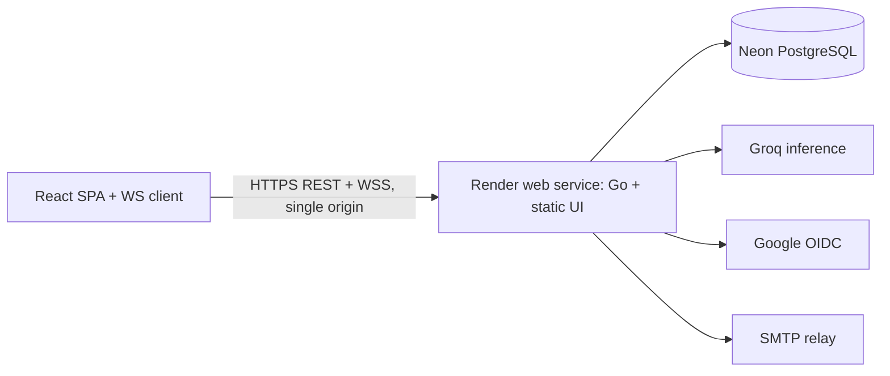

# Deployment And Operations (Render)

## Topology

One Render **web service** runs the single Docker image (`backend/Dockerfile`):
the Go binary serves `/api/*`, `/ws/*`, `/health/*`, `/version`, and the Vite
SPA from `/srv` — UI and API share one origin, so there is no CORS and cookies
stay `SameSite=Lax`. Managed **Neon Postgres** is the database; Groq,
Google, and an SMTP relay are external services. No host to SSH into, no
reverse proxy, no container orchestrator to operate.

| Environment | Compute | Database | External services |
|---|---|---|---|
| local | `vite dev` + `go run`, or `docker compose up --build` | local Postgres / Neon dev branch | mock AI/OIDC/mail by default |
| CI | GitHub Actions (Go tests, frontend checks, contract) | Postgres 18 service | mocks only |
| production | one Render web service (free tier; `starter` when no-sleep is needed) | Neon production project | Google prod client, Groq free-tier key, SMTP relay |

The free tier sleeps after ~15 min without traffic and wakes in ~60 s on the
next visit. That is fine for portfolio/demo use: open the URL a minute before
a live quiz, and the service stays awake while participants interact. Upgrade
to `starter` (paid, card required) only when back-to-back sessions make the
wake delay annoying.

## Release Flow

Releases are immutable git tags (`v*`). `autoDeploy: false` in `render.yaml`
so the deploy workflow — not Render — decides when a release ships, and
**migrations always land before the new image boots**:

1. Push tag `v*` (or run `workflow_dispatch`). The `deploy` workflow:
   1. runs `migrate/migrate:v4.18.3` against `MIGRATIONS_DATABASE_URL`
      (Neon **direct** URL; the `postgresql://` → `postgres://` scheme fix is
      in the workflow), then
   2. POSTs the Render deploy hook (`RENDER_DEPLOY_HOOK_URL`), then
   3. polls `$RENDER_APP_URL/health/ready` and prints `/version`.
2. Render builds `backend/Dockerfile` (multi-arch not needed — Render is
   amd64), boots with `PORT` injected (the binary prefers `PORT` over
   `HTTP_ADDR`), and routes traffic only after `/health/ready` passes.
3. The `production` GitHub environment requires a human approver.

GitHub secrets for `deploy`: `MIGRATIONS_DATABASE_URL`, `RENDER_DEPLOY_HOOK_URL`,
`RENDER_APP_URL`. Render-side config lives in `render.yaml` (non-secrets) plus
dashboard values for every `sync: false` entry (database URL, Google, Groq, SMTP).

## First-Time Setup

1. **Neon** — production project; note the pooled runtime URL (`DATABASE_URL`,
   `?sslmode=require`) and the direct URL (`MIGRATIONS_DATABASE_URL`).
2. **Render** — `render blueprint launch` from this repo (or `render up`);
   fill the `sync: false` values; confirm `APP_ORIGIN`/`WS_ALLOWED_ORIGINS`
   equal the service URL exactly (no trailing slash).
3. **Google** — OAuth client with redirect
   `https://<service>/api/v1/auth/google/callback` registered exactly.
4. **Groq** — free-tier API key from console.groq.com; model
   `openai/gpt-oss-120b` with strict `json_schema` (already the code default).
   Free-tier rate limits apply (fine for generation-on-demand, not bulk).
   App quotas (`AI_DAILY_USER_LIMIT=5`) bound usage regardless.
5. **SMTP** — any relay; set `MAIL_PROVIDER=smtp`, `SMTP_ADDR` (`host:587`),
   credentials, and a verified `MAIL_FROM`.
6. **Retention janitor** — Render cron job, command `/quizforge janitor`, same
   env group as the web service, daily. Safe to re-run; only expired/transient
   rows are deleted (never quiz results, answers, or live user data).
7. **Release** — push a `v*` tag, approve `production`, watch the workflow
   smoke pass, then run the browser smoke below.

## Smoke (after every release)

`GET /health/ready` → 200, `GET /version` shows the release tag, landing page
loads, register → login → generate (or author) → publish → host → join by code
on a second browser → answer → results → history.

## Backup And Disaster Recovery

- Neon point-in-time restore is the first line (verify the plan's window; free
  history is not a backup guarantee).
- `deploy/scripts/backup.sh` takes a manual `pg_dump --custom` anywhere with
  Postgres client tools — run before any `migrate down`, keep the artifact
  off-site. Restore: `pg_restore --no-owner -d "$MIGRATIONS_DATABASE_URL"`.
- App rollback: Render dashboard → Deploys → **Rollback** to the previous
  image (see `deploy/scripts/ROLLBACK.md`); DB rollback is forward-fix first,
  `down 1` only with a fresh backup.
- Target RPO 24 h (backup), RTO 4 h solo-operated; replace with measured drill
  numbers once run.

## Monitoring And Runbooks

Render gives CPU/memory logs and deploy history; the app adds JSON logs with
request IDs, `/health/live` (process) vs `/health/ready` (DB + migrations),
and metadata-only logging (no tokens, answers, or provider content).

Runbooks cover: API down (check Render events → `/health/ready` → Neon status),
DB waking (Neon scale-to-zero cold start is transient — retry before paging),
high 5xx, AI outage/quota, Google login failure, SMTP bounces, stuck live
question (server timers close rounds idempotently; reconnect resyncs from DB),
backup failure, and rollback. Each names detection, impact, diagnosis,
mitigation, verification, follow-up.

## Production Checklist

- `APP_ORIGIN`/`WS_ALLOWED_ORIGINS`/`GOOGLE_REDIRECT_URL` exactly match the
  Render URL; `CSRF_SECRET` ≥ 32 chars; production `DATABASE_URL` requires TLS.
- Migrations + restore drill pass; janitor cron scheduled; spend caps set
  (Render plan, Groq limits, Neon limits).
- Two-browser live smoke incl. mid-question refresh; headers scanned
  (CSP/HSTS come from Render edge + the app's `SecurityHeaders`).
- Argon2 stays at the secure baseline (64 MiB × 3 × p2); calibrate only with
  measured data on the serving hardware, never by weakening parameters.
