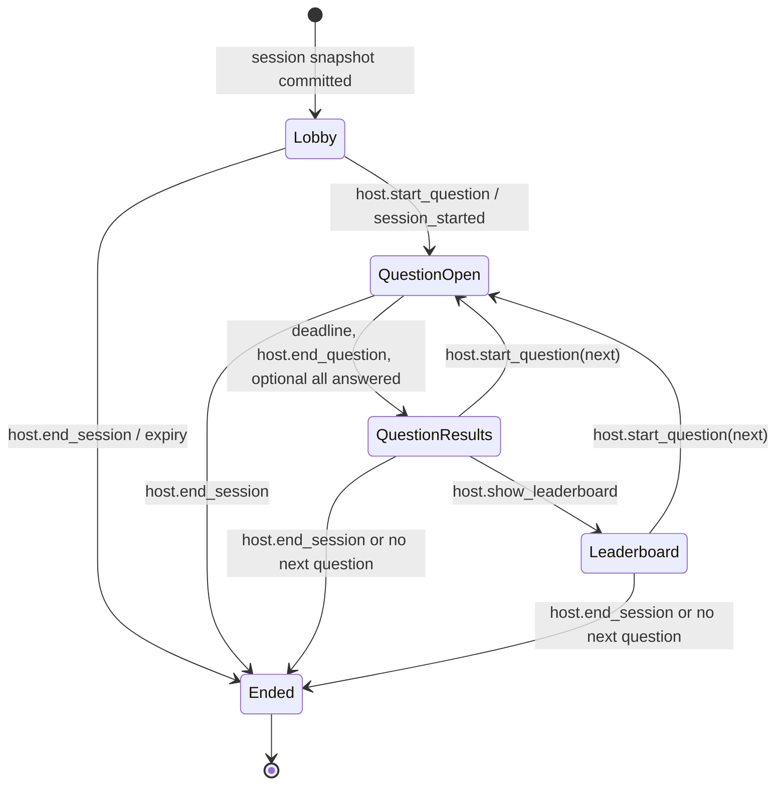

# Real-Time Design

## Connection And Envelope

Endpoint: `GET /ws/v1/sessions/{sessionId}?lastVersion=17`. Upgrade is same-origin `wss`. Cookies identify either the creator host session or one participant resume token. The server validates `Origin` against `APP_ORIGIN`, session membership, expiry, and role before upgrade. Join codes never authenticate a socket.

All messages use:

```json
{
  "v": 1,
  "type": "question_started",
  "eventId": "session-uuid:18",
  "sessionId": "uuid",
  "stateVersion": 18,
  "sentAt": "2026-10-10T12:00:00.123Z",
  "requestId": null,
  "payload": {}
}
```

Client commands have `requestId` UUID and, for transitions, `expectedVersion`. Server acknowledgements repeat `requestId`. Maximum message is 16 KiB; text JSON only; unknown version/type or invalid shape receives `session_error`, with close after repeated violations.

Ordering rule: a command acknowledgement and its resulting broadcast may arrive in either order for the commanding client (the ack is written directly; broadcasts fan out through the client pump). Clients must correlate via `requestId` and order state via `stateVersion`, never via arrival order. The durable invariant is unaffected: the database mutation always commits before either frame is sent.

## Identity And Audience Classes

- `host`: authenticated creator whose ID equals `live_session.host_user_id`; gets answer keys, connected participant list, submission count, and controls.
- `participant`: resume-token hash resolves to participant in this session; gets public state plus own acknowledgements/score.
- No anonymous spectator socket in MVP.

One browser may have multiple tabs. The server tracks sockets, not "online users"; participant presence changes only on first connection/last disconnect with a five-second disconnect grace to prevent refresh flicker.

## Commands

| Type | Sender | Payload | Validation / result |
|---|---|---|---|
| `host.start_question` | host | `{questionPosition}` | lobby/results/leaderboard; expected next position; persists deadline |
| `host.end_question` | host | `{}` | only open; closes early idempotently |
| `host.show_leaderboard` | host | `{}` | only results; persists leaderboard state |
| `host.end_session` | host | `{}` | non-ended; persists final event |
| `participant.submit_answer` | participant | `{submissionId,questionId,optionIds}` | current open question, 1 option MVP, one accepted answer |
| `client.resync` | either | `{lastVersion}` | returns snapshot or missed public events |
| `client.ping` | either | `{clientTime}` | returns pong/server time; protocol-level ping also used |

Every host command is idempotent by `commandId/requestId` in a bounded command-result store or durable event metadata. An answer is idempotent by `submissionId` and participant/question uniqueness.

## Server Events

| Event | Sender -> recipients | Required payload | Error/security behavior |
|---|---|---|---|
| `state_snapshot` | server -> one client | role-filtered session state, `serverTime`, latest version | sent after connect/resync; embargo enforced |
| `participant_joined` | server -> host | participant ID/name, participant count | public participant clients receive count-only `participant_count_changed` |
| `participant_left` | server -> host | participant ID, count | emitted after disconnect grace; not durable truth of participation |
| `session_started` | server -> all | first question position/count | may accompany first `question_started` version sequence |
| `question_started` | server -> all | question ID/position/prompt/options, `startedAt`, `endsAt`, scoring mode | participant payload omits correctness/explanation |
| `answer_acknowledged` | server -> submitting participant | submission ID, question ID, accepted/duplicate, receivedAt | does not reveal correctness while open |
| `answer_submitted` | server -> host | participant ID, question ID, submitted count | never includes selection in presentation UI event |
| `question_ended` | server -> all | question ID, endedAt, reason | reason `timer,host,all_answered` if auto-close policy enabled |
| `question_results` | server -> all | correct IDs, explanation, option counts, own correctness/points; host gets full aggregates | generated only after durable close |
| `leaderboard_updated` | server -> all | ranked top N, own rank/score | names visible by product setting; default top 10 |
| `session_ended` | server -> all | endedAt, final leaderboard, own result | terminal; socket closes after grace |
| `session_error` | server -> one client | stable code/message/retryable/requestId/currentVersion | no internal details |
| `server_restart` | server -> all | `retryAfterMs` | best-effort graceful shutdown notice |
| `pong` | server -> one | server/client time | no state change/version increment |

Not every ephemeral presence or acknowledgement increments state. Durable state-changing events do. `stateVersion` is monotonic per session; clients discard lower versions and resync on gaps.

The frontend models messages as a discriminated union. `UUID` and `DateTime` mean canonical UUID and RFC 3339 UTC string. Fields shown are required unless marked `?`; all object decoders reject unknown fields.

```ts
type ServerEvent =
  | Event<"state_snapshot", RoleFilteredSnapshot>
  | Event<"participant_joined", {participantId: UUID; displayName: string; participantCount: number}>
  | Event<"participant_left", {participantId: UUID; participantCount: number}>
  | Event<"participant_count_changed", {participantCount: number}>
  | Event<"session_started", {questionCount: number; firstQuestionPosition: number}>
  | Event<"question_started", {
      question: {id: UUID; position: number; prompt: string; options: {id: UUID; text: string; position: number}[]};
      startedAt: DateTime; endsAt: DateTime; serverTime: DateTime; scoringMode: "fixed" | "speed";
    }>
  | Event<"answer_acknowledged", {
      submissionId: UUID; questionId: UUID; outcome: "accepted" | "duplicate";
      receivedAt: DateTime;
    }>
  | Event<"answer_submitted", {participantId: UUID; questionId: UUID; submittedCount: number}>
  | Event<"question_ended", {questionId: UUID; endedAt: DateTime; reason: "timer" | "host" | "all_answered"}>
  | Event<"question_results", {
      questionId: UUID; correctOptionIds: UUID[]; explanation: string;
      options: {id: UUID; count: number; percentage: number}[];
      ownResult?: {isCorrect: boolean; points: number};
    }>
  | Event<"leaderboard_updated", {
      leaders: {participantId: UUID; displayName: string; rank: number; score: number; delta: number}[];
      ownStanding?: {rank: number; score: number};
    }>
  | Event<"session_ended", {endedAt: DateTime; finalLeaderboard: Leader[]; ownStanding?: Standing}>
  | Event<"session_error", {
      code: string; message: string; retryable: boolean; retryAfterMs?: number; currentVersion?: number;
    }>
  | Event<"server_restart", {retryAfterMs: number}>
  | Event<"pong", {clientTime?: DateTime; serverTime: DateTime}>;

type ClientCommand =
  | Command<"host.start_question", {questionPosition: number}, true>
  | Command<"host.end_question", Record<string, never>, true>
  | Command<"host.show_leaderboard", Record<string, never>, true>
  | Command<"host.end_session", Record<string, never>, true>
  | Command<"participant.submit_answer", {submissionId: UUID; questionId: UUID; optionIds: UUID[]}, false>
  | Command<"client.resync", {lastVersion: number}, false>
  | Command<"client.ping", {clientTime?: DateTime}, false>;
```

`Event<T,P>` contains the common server envelope. `Command<T,P,true>` additionally requires `expectedVersion`; every command requires `requestId`. Host-only fields are removed before serializing a participant event, not merely hidden by the UI. Schema violations receive `session_error(code="INVALID_MESSAGE")`; role violations receive `FORBIDDEN`; invalid state/version returns current version and triggers resync. Repeated invalid/unauthorized messages close the socket.

## Example Question Event

```json
{
  "v":1,
  "type":"question_started",
  "eventId":"018f...:8",
  "sessionId":"018f...",
  "stateVersion":8,
  "sentAt":"2026-10-10T12:00:00Z",
  "requestId":"2af6...",
  "payload":{
    "question":{"id":"...","position":0,"prompt":"Which keyword declares a variable?","options":[{"id":"...","text":"let"},{"id":"...","text":"var"}]},
    "startedAt":"2026-10-10T12:00:00Z",
    "endsAt":"2026-10-10T12:00:30Z",
    "serverTime":"2026-10-10T12:00:00.010Z"
  }
}
```

## State Machine



Invalid transitions return `INVALID_STATE` with current state/version and do not mutate. Starting position must be the first unanswered/next sequential question; skipping is a post-MVP setting. A terminal session never reopens.

## Authoritative Timers

The database stores server `started_at` and `ends_at`. Clients render `max(0, endsAt - estimatedServerNow)` using the server time offset from snapshot/pong; browser intervals are presentation only. The server accepts an answer only when its own receipt time is `<= ends_at`. No latency compensation is applied in MVP because it is exploitable; display copy says "received" only after ack. At deadline, an actor timer requests close, but close SQL checks time/state so restart or duplicate timers are safe.

If all currently joined participants have answered, the default MVP still waits for the timer unless the host ends early; this prevents late join/presence races. An `autoCloseWhenAllAnswered` option can be added later with a locked eligible-participant set.

## Scoring

Incorrect/no answer: 0. Fixed correct: `basePoints`. Speed correct:

```text
duration_ms = ends_at - started_at
remaining_ratio = clamp((ends_at - received_at) / duration_ms, 0, 1)
score = round(basePoints * (0.5 + 0.5 * remaining_ratio))
```

With base 1000 this awards 500-1000. The server derives timestamps, correctness, and score. Ties rank by total score descending, then total correct descending, then cumulative response milliseconds ascending, then `joined_at`, then participant ID for deterministic order. Store points/response time per answer so leaderboard can be rebuilt.

## Reconnection

Client reconnect uses exponential backoff with full jitter: 0.5, 1, 2, 4, 8 seconds, capped at 10, reset after 30 seconds stable. The browser keeps only non-secret UI state in memory; HttpOnly cookie authenticates reconnect. It sends last applied version. Server behavior:

- if retained events cover the gap, send role-filtered events in order;
- otherwise send `state_snapshot`;
- if an answer was sent but not acknowledged, resend the same `submissionId`; uniqueness returns original ack;
- if session ended/expired, send terminal snapshot then close.

Host refresh is identical. The host regains controls only after snapshot and cannot use a stale `expectedVersion`.

## Heartbeats And Backpressure

Server protocol ping every 20 seconds; pong deadline 10 seconds; close after failure. Application pong is available for clock offset. Read limit 16 KiB, write timeout 5 seconds, idle limit 45 seconds. Outbound queue is 64 messages/client. Coalesce replaceable count/presence updates; never drop question, result, ack, leaderboard, error, or end events. Disconnect slow clients with close code `4008` and reason `slow_consumer` so they resync.

## Restart Recovery

At startup, query non-ended sessions. For each, create actor and:

1. if open and deadline is future, schedule remaining duration;
2. if open and deadline passed, execute idempotent close transaction;
3. if lobby/results/leaderboard, await host;
4. if `expires_at` passed, end with expiry reason.

The actor holds IDs/version/deadline, not authoritative uncommitted state. Broadcasts occur only after commit. Clients disconnected during restart recover through snapshot. Session events support a short replay window but are not required to rebuild because normalized live tables are sufficient.

## Host Disconnect And Expiry

Host disconnect does not pause an open timer. After it closes, participants remain on results/waiting state. Lobby or waiting sessions expire after 2 hours of no host connection; active session hard maximum is 6 hours. A warning is shown before expiry. Participant disconnect never removes answers/scores. `participant_left` is presence, not deletion.

## Abuse And Security

- Strict origin allowlist and same-origin cookie posture; no token in query string or local storage.
- Rate limits: upgrades 10/min/IP, joins 20/min/IP and 5/min/code/IP, commands 20/sec/socket burst 40, answers 5/sec/socket but uniqueness remains final control.
- Normalize/escape all names; React renders text, never raw HTML.
- Participant message schemas are type-specific and role-authorized; extra fields rejected.
- Logs include event type, result code, session/participant internal IDs, size, latency; never cookie, token, selected answer, question text, or answer key.
- Close codes: `4001` unauthenticated, `4003` forbidden, `4004` session gone, `4008` slow/rate limited, `4010` incompatible protocol, `1012` restart.

## Multi-Instance Evolution

Add an ALB and Redis only after evidence requires replicas. A Redis lease elects one actor owner/session; commands route through Streams or a brokered RPC; Pub/Sub fans broadcasts; shared presence and rate limits move to Redis. PostgreSQL uniqueness/version/transactions stay authoritative. Test lease loss, duplicate delivery, split brain, and reconnect before enabling more than one replica.
