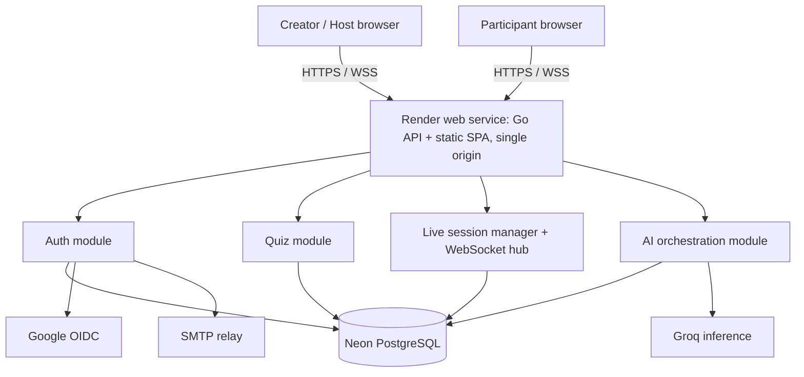
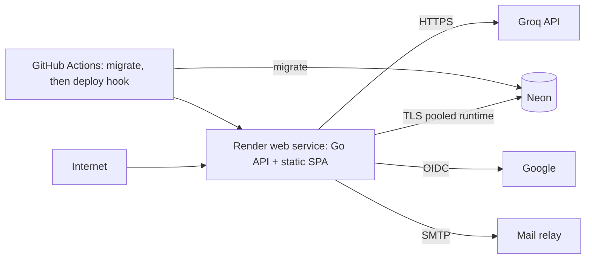

# System Architecture

## Decision Summary

Build one stateless-at-the-process-boundary Go modular monolith with an in-process WebSocket hub and per-session actor goroutines. PostgreSQL is the durable source of truth; memory accelerates routing and timers but is never the only copy of live state. React is compiled to static assets and served by the Go binary from the same image. One Render web service runs UI + API on a single origin; Neon, Groq, Google, and an SMTP relay remain managed external dependencies.

## Context Diagram



## Deployment Topology



No load balancer, NAT gateway, Redis, or container orchestrator is required for the MVP. Render terminates TLS and gates traffic on `/health/ready`; this knowingly accepts a single-instance failure domain in exchange for low cost and comprehensibility.

## Module Boundaries

| Module | Owns | Does not own |
|---|---|---|
| `auth` | users, credentials, identities, sessions, CSRF, OAuth, recovery | quiz ownership decisions beyond user identity |
| `quiz` | quiz aggregate, validation, versions, publication, snapshots | AI transport, live scoring |
| `ai` | provider calls, prompts, output validation, generation usage | direct partial writes to quiz tables |
| `live` | session state machine, join, sockets, timers, answers, scoring, events | quiz editing |
| `reporting` | creator history, aggregates, exports | live mutation |
| `platform` | config, DB, logging, HTTP, rate limits, clock, IDs, shutdown | domain rules |

Handlers parse transport input and call services. Services enforce authorization and transactions. Repositories contain generated `sqlc` queries plus narrow handwritten transaction orchestration. External clients implement interfaces behind the owning module.

## Request Lifecycle

1. Render terminates TLS; the Go binary serves `/assets` (immutable cache), the SPA fallback, `/api/*`, and `/ws/*` from one process.
2. Go middleware assigns/validates `X-Request-ID`, recovers panics, records structured metrics, checks trusted proxy configuration, applies origin and rate limits, then authenticates cookies.
3. Handler decodes one JSON object with `DisallowUnknownFields`, validates transport shape, and invokes a domain service.
4. Service reloads relevant ownership/state, applies business rules, and opens a bounded transaction when mutating.
5. Repository uses parameterized generated SQL. Service commits before publishing real-time events.
6. Response uses a typed DTO; internal/domain/database errors map to the stable error envelope.

## Authentication Flow

### Password

Register validates normalized identifiers, hashes outside the database transaction with Argon2id, inserts user/identity/session atomically, and sets an opaque session cookie. Login performs a constant-shape lookup, verifies against a real or dummy hash, rotates the session, and returns the same generic error for unknown user and wrong password.

### Google OIDC

```mermaid
sequenceDiagram
  participant B as Browser
  participant A as Go auth module
  participant G as Google OIDC
  participant D as PostgreSQL
  B->>A: GET /auth/google/start
  A->>D: store hash(state), hash(nonce), PKCE verifier, expiry
  A-->>B: 302 Google authorization endpoint
  B->>G: authenticate and consent
  G-->>B: redirect code + state
  B->>A: GET /auth/google/callback
  A->>D: consume state once
  A->>G: exchange code with verifier
  A->>A: verify signature, iss, aud, nonce, exp, email_verified
  A->>D: create identity/user or require explicit account link
  A-->>B: rotate cookie; 303 /app
```

Only `openid email profile` scopes are requested. Google access/refresh tokens are not retained because the app needs authentication, not ongoing Google API access.

## AI Generation Flow

```mermaid
sequenceDiagram
  participant UI as Generator UI
  participant API as Go AI service
  participant DB as PostgreSQL
  participant Groq as Groq
  UI->>API: POST brief + Idempotency-Key
  API->>DB: reserve generation record / enforce quota
  API->>Groq: chat completion + strict JSON Schema
  Groq-->>API: structured JSON or error
  API->>API: parse, schema + domain + quality validation
  alt retryable invalid/provider failure
    API->>Groq: one corrective retry with bounded backoff
    Groq-->>API: corrected output
  end
  alt valid
    API->>DB: transaction: quiz + questions + options + usage
    API-->>UI: 201 generated draft
  else unavailable/invalid
    API->>DB: finalize failure metadata
    API-->>UI: stable 422/429/503; no partial quiz
  end
```

## Live Quiz Lifecycle

1. Host starts a session from a published quiz. One transaction inserts the live session plus immutable question/option snapshots and a durable lobby event.
2. The manager creates a session actor. Commands enter one buffered channel and execute serially; sockets subscribe to role-filtered broadcasts.
3. Host command includes `expectedVersion`. The actor validates role/state, persists transition under a row lock, commits, then broadcasts event containing the new version.
4. A question deadline is persisted. The process timer is only a wake-up hint; close logic compares database/server time and is idempotent.
5. An answer transaction locks/validates the live session, inserts the unique participant/question answer and selections, computes score, and updates participant total. Only committed answers produce acknowledgements/events.
6. On process start, the manager loads non-ended sessions, reconstructs actors, and closes overdue questions once. On client reconnect, it sends a role-filtered authoritative snapshot and optionally events newer than `lastVersion`.

See `REALTIME_DESIGN.md` for the full state machine and protocol.

## Concurrency Model

- One lightweight actor goroutine per active session serializes host transitions and timer actions.
- WebSocket read and write pumps are separate goroutines with one bounded outbound queue/client and one writer/client.
- Answer submission does not rely solely on the actor queue: the database uniqueness constraint and transaction are the final guard, allowing target bursts without blocking host control behind every answer.
- Broadcast payloads are immutable byte slices prepared once per audience class. Slow clients whose queue remains full are disconnected with a retryable close code.
- Every goroutine is rooted in application/session/client context and terminates on cancellation. CI runs `go test -race` on concurrency packages.

## Graceful Shutdown

On `SIGTERM`: mark readiness false; stop accepting new upgrades; cancel provider work; allow HTTP requests 15 seconds; tell sockets `server_restart` with retry delay; persist no special in-memory state because each transition/answer is already durable; close sockets; stop actors; close DB pool; exit within 25 seconds. Docker grants 30 seconds.

## Configuration

Configuration loads once from environment into a typed struct, validates cross-field invariants, and fails fast. Secrets are never logged. Development may load `.env`; production injects env from the Render dashboard / env group. See `.env.example`.

## Observability

- JSON logs: timestamp, level, service, version, request/event ID, route template, method, status, duration, user/session IDs as non-reversible or internal UUIDs, error code. Never content or tokens.
- Prometheus-compatible `/metrics` bound to loopback or protected network; begin with embedded metrics logs and Render's own CPU/memory graphs.
- Metrics: HTTP latency/errors, DB pool, active sockets/sessions, command latency/conflicts, answer outcome, broadcast drops, AI calls/latency/schema failures, auth outcomes/rate limits.
- Traces are optional after metrics/logs; OpenTelemetry instrumentation must not block MVP.
- Liveness proves process/event-loop health. Readiness performs a short DB ping and migration-version check, but not Groq/Google availability.

## Scaling Path

Vertical scale is first: a larger Render plan, DB pool tuning, query analysis, and socket limits. For multiple API instances, introduce Redis only with a new ADR: distributed session command ownership/leases, Pub/Sub broadcasts, shared rate limits, and connection presence. PostgreSQL remains the durable state and idempotency authority. Do not simply add replicas to the MVP because in-process actors would diverge.

## Failure Modes

| Failure | User behavior | System behavior |
|---|---|---|
| Neon wakes from idle | brief retry/loading | bounded connection/query timeout; retry only safe reads/transactions before effects |
| Groq 429/outage | preserve prompt; offer retry/manual | one bounded retry where allowed; circuit breaker; `503 AI_UNAVAILABLE` |
| Host disconnects | participants finish current timer and wait | state remains; automatic close proceeds; no automatic advance |
| Participant disconnects | reconnect banner, then snapshot | answer and identity persist; no duplicate score |
| API restart | clients reconnect | active states/timers loaded from DB; overdue question closes once |
| Slow socket | reconnect prompt | bounded queue, disconnect; other participants unaffected |
| Database unavailable during answer | pending then explicit not-accepted | never acknowledge before commit; client retries same `submissionId` |
| Stale host tab | refresh required | expected-version conflict and authoritative snapshot |
